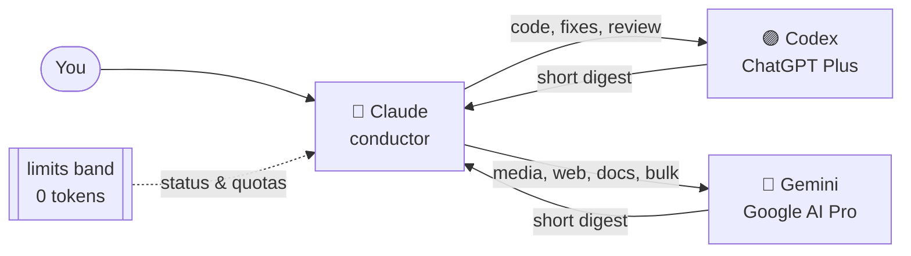

<div align="center">



# Claude × Codex × Antigravity

**Use your ChatGPT Plus and Google AI Pro subscriptions from inside Claude Code,
and stop burning Claude's limits on work another model does better.**

[](https://claude.com/claude-code)
[](https://github.com/openai/codex-plugin-cc)
[](https://antigravity.google)
[](LICENSE)


[English](README.md) · [Русский](README.ru.md)

</div>

---

## Why

You probably pay for more than one AI. Claude is a great conductor, but its 5-hour window
runs out fast when it watches a video, reads 40 PDFs or reviews a big diff on its own.

This repo turns Claude Code into the **conductor of three subscriptions**:

| Who | Does what | Paid by |
|---|---|---|
| 🦀 **Claude** | understands, plans, decides, makes small edits, checks what others return | your Claude plan |
| 🟣 **Codex** | writes, fixes and reviews code | your ChatGPT Plus |
| 🔷 **Gemini** (Antigravity) | video, audio, images, YouTube, web research, documents, scraping, site review, bulk reading | your Google AI Pro |

Claude only ever reads the short result, so a 2-hour video or a folder of scans
costs it a few hundred tokens instead of its whole window.

## What's inside

### 1. `agy`: Gemini inside Claude Code

A 2-in-1 plugin built from the two best community Antigravity plugins: the robust engine
of [yuting0624/antigravity-for-claude-code](https://github.com/yuting0624/antigravity-for-claude-code)
and the feature set of [MarcosNahuel/antigravity-plugin-cc](https://github.com/MarcosNahuel/antigravity-plugin-cc),
merged without duplicates and with safe permissions.

| Command | What it does |
|---|---|
| `/agy:media` | Audio, video, image or YouTube link → transcript + digest, a question, or a scene-by-scene breakdown. *Claude can't watch video. Gemini can.* |
| `/agy:research` | Web research with sources, `low` / `medium` / `high` depth, saved as a report |
| `/agy:deep-research` | Claude plans and judges, Gemini browses each angle, then red-teams the claims |
| `/agy:notebook` | **A local NotebookLM**: a folder of PDFs, scans, Word files and images → per-document summaries, an index and a master summary for your goal |
| `/agy:notebook-ask` | Ask the folder questions: exact numbers from its database, citations checked |
| `/agy:doc-to-md` | PDF / Word / scan → clean Markdown (OCR included) |
| `/agy:scrape` | A web page → a table or JSON (prices, lists, contacts, specs) |
| `/agy:design-review` | UX and visual audit of a site (localhost too): desktop + mobile screenshots, 10 dimensions, a score and top fixes |
| `/agy:record` | Records a browser walkthrough: `.webm` / `.mp4`, screenshots, a step report |
| `/agy:delegate` | Hand off bulk reading, generation or a second opinion; `--background` for long jobs |
| `/agy:jobs` | List, follow or cancel background jobs |
| `/agy:review` · `/agy:handoff` | Second-opinion code review and a code fallback for when Codex is out of quota |
| `/agy:ask` · `/agy:model` · `/agy:setup` | Quick question · pick models for each tier · install and safe setup |

What it adds on top of the originals:

- **Narrow permissions by default.** Gemini may write only into `~/.agy-work`, read web pages and drive its browser. Writing into a project needs your OK (`agy-setup allow-write <folder>`). No blanket auto-approve.
- **No Claude subagents.** The NotebookLM pipeline runs as a plain script with parallel waves, retries and a cache. The old version spent about 60k Claude tokens per subagent.
- **A skill with measured lessons**: batch instead of chatting, never trust Gemini's "tests pass", `--continue` costs more than a fresh run, and more. See [`skills/gemini/SKILL.md`](plugins/agy/skills/gemini/SKILL.md).
- **Clear exit codes** (10 quota, 11 signed out, 12 timeout, 13 not installed, 15 refused), so Claude stops sending work to a provider that can't take it.
- **Works on Windows**: Git Bash paths, the `python3` Store stub, cp1252 consoles and `cmd /c` quoting are all handled.

### 2. `limits`: every subscription's limits, without spending tokens

<div align="center">

</div>

A band above the prompt with the **5-hour and weekly windows of all three subscriptions**,
plus Claude's context fill:

- **Zero tokens.** Claude's numbers come from the engine itself. Codex's come from the Codex app-server (`account/rateLimits/read`), and Gemini's from Antigravity's own status line and ACP handshake. No model is ever called to check a limit.
- **Shows what's disconnected.** A provider that isn't installed or signed in shows a dashed "not connected" chip instead of fake zeros.
- **Tells Claude how to route.** Once per conversation Claude gets a short policy and the current numbers, plus a one-line note only when something changes, so the prompt cache survives. When Codex runs out, Claude stops sending it code and says so.
- **A "Compact" button** when the context passes 50%, and a `/limits` pane with reset times and Gemini activity.
- **🦀 Every three minutes the Claude crab walks over, kicks the Codex and Gemini icons and runs back home.** It respects `prefers-reduced-motion`.

The band is a single SVG with CSS animation, which the GPU composites. Codex is checked every 3 minutes, a process that lives about a second. Gemini's file is read every minute. On a normal laptop you won't notice it.

> The `limits` band is a **mod**: it draws UI with Claude Code's hooks modules, which need a recent Claude Code; it looks best in the **desktop app**. In a terminal it falls back to a text line.

## Install

**1. Add this marketplace and the plugins** (in Claude Code):

```text
/plugin marketplace add diasissatayev/Claude_and_Antigravity-
/plugin install agy@claude-and-antigravity
/plugin install limits@claude-and-antigravity
```

**2. Add Codex**, OpenAI's official plugin:

```text
/plugin marketplace add openai/codex-plugin-cc
/plugin install codex@openai-codex
/codex:setup
```

**3. Set up Antigravity:**

```text
/agy:setup
```

It checks that `agy` is installed and signed in to your Google account, sets narrow
permissions and turns on quota tracking for the band. Then run `/reload-plugins`.

### Requirements

- Claude Code (the desktop app is recommended for the band)
- Node.js 18+ and Python 3.10+
- Git (on Windows, Git for Windows provides the Bash the scripts run in)
- Codex CLI and a ChatGPT Plus (or higher) plan
- Antigravity CLI (`agy`) and a Google AI Pro (or higher) plan

Both extra subscriptions are optional: if one is missing, the band shows it as not
connected and Claude does that work itself.

## How routing works



- Small, quick or judgement-heavy work stays with Claude: describing it and checking the result would cost more.
- Big or specialised work goes out, and **only the digest comes back**. Full outputs stay in files.
- Anything Claude will rely on is verified, not taken on trust.
- When Claude's own 5-hour window passes 80%, it delegates more eagerly.

## Examples

```text
/agy:media https://youtu.be/... what are the three main arguments, with timestamps?
/agy:notebook ./contracts  find every termination clause and notice period
/agy:research high  best open-source vector DB for 10M embeddings on one machine
/agy:design-review http://localhost:3000
/codex:review
/limits
```

## Credits

- [yuting0624/antigravity-for-claude-code](https://github.com/yuting0624/antigravity-for-claude-code): the delegation engine and the measured lessons (MIT)
- [MarcosNahuel/antigravity-plugin-cc](https://github.com/MarcosNahuel/antigravity-plugin-cc): media, research, notebook, scrape, design review and record features (MIT)
- [openai/codex-plugin-cc](https://github.com/openai/codex-plugin-cc): the official Codex plugin this works alongside
- The pixel crab is drawn after Claude's mascot.

Original licenses are kept in [`plugins/agy/`](plugins/agy).

## License

[MIT](LICENSE). This is an independent community project, not affiliated with Anthropic, OpenAI or Google.

<div align="center">

**If this saved your limits, a ⭐ helps others find it.**

</div>
