<div align="center">



# Claude × Codex × Antigravity

**Подписки ChatGPT Plus и Google AI Pro прямо внутри Claude Code,
чтобы лимиты Claude не уходили на работу, которую другая модель сделает лучше.**

[English](README.md) · [Русский](README.ru.md)

</div>

---

## Зачем

Если вы платите больше чем за один ИИ, этот репозиторий делает Claude Code
**дирижёром трёх подписок**:

| Кто | Что делает | Чья подписка |
|---|---|---|
| 🦀 **Claude** | понимает задачу, планирует, решает, делает мелкие правки, проверяет результат | Claude |
| 🟣 **Codex** | пишет, чинит и ревьюит код | ChatGPT Plus |
| 🔷 **Gemini** (Antigravity) | видео, аудио, картинки, YouTube, поиск в интернете, документы, парсинг сайтов, ревью дизайна, чтение больших объёмов | Google AI Pro |

Claude читает только краткий итог: двухчасовое видео или папка сканов обходится ему
в несколько сотен токенов, а не во всё 5-часовое окно.

## Что внутри

### 1. `agy`: Gemini в Claude Code

Плагин «2 в 1» из двух лучших плагинов сообщества для Antigravity: движок
[yuting0624](https://github.com/yuting0624/antigravity-for-claude-code) и возможности
[MarcosNahuel](https://github.com/MarcosNahuel/antigravity-plugin-cc). Дубли убраны,
права у Gemini узкие.

| Команда | Что делает |
|---|---|
| `/agy:media` | Аудио, видео, картинка или YouTube: расшифровка и выжимка, ответ на вопрос или разбор по сценам. *Claude не умеет смотреть видео, Gemini умеет.* |
| `/agy:research` | Поиск в интернете с источниками, глубина `low` / `medium` / `high`, отчёт в файл |
| `/agy:deep-research` | Claude планирует и оценивает, Gemini ищет по каждому направлению и проверяет утверждения |
| `/agy:notebook` | **Локальный NotebookLM**: папка PDF, сканов, Word и картинок превращается в выжимки, индекс и общий итог под вашу цель |
| `/agy:notebook-ask` | Вопросы к папке: точные цифры из базы, ссылки проверяются |
| `/agy:doc-to-md` | PDF, Word или скан в чистый Markdown (с распознаванием текста) |
| `/agy:scrape` | Данные со страницы в таблицу или JSON |
| `/agy:design-review` | Аудит сайта (и localhost): скриншоты на компьютере и телефоне, 10 критериев, оценка, главные исправления |
| `/agy:record` | Запись прохода по сайту: видео, скриншоты, отчёт по шагам |
| `/agy:delegate` · `/agy:jobs` | Передать объёмную работу, в том числе в фоне, и следить за ней |
| `/agy:review` · `/agy:handoff` | Второе мнение по коду и запасной вариант, когда у Codex кончилась квота |
| `/agy:ask` · `/agy:model` · `/agy:setup` | Быстрый вопрос · выбор моделей · установка и безопасная настройка |

### 2. `limits`: лимиты всех подписок без траты токенов

<div align="center">

</div>

- 5-часовое и недельное окно у Claude, Codex и Gemini, плюс заполненность контекста Claude.
- **Ноль токенов**: цифры берутся из самого Claude Code, из сервера Codex и из статуса Antigravity. Ни одна модель для этого не вызывается.
- Неподключённая подписка видна сразу и не показывает выдуманные нули.
- Claude знает, кому отдавать работу, и получает короткую заметку только когда что-то меняется.
- Кнопка «Сжать», когда контекст заполнен больше чем наполовину, и панель `/limits` со временем сброса.
- 🦀 Раз в три минуты краб Claude идёт, пинает значки Codex и Gemini и убегает обратно.

## Установка

```text
/plugin marketplace add diasissatayev/Claude_and_Antigravity-
/plugin install agy@claude-and-antigravity
/plugin install limits@claude-and-antigravity

/plugin marketplace add openai/codex-plugin-cc
/plugin install codex@openai-codex
/codex:setup

/agy:setup
/reload-plugins
```

Нужны Node.js 18+, Python 3.10+ и Git (на Windows: Git for Windows). Подписки ChatGPT Plus
и Google AI Pro необязательны: если какой-то нет, полоска покажет её как не подключённую,
и Claude сделает эту работу сам.

## Благодарности

[yuting0624](https://github.com/yuting0624/antigravity-for-claude-code) и
[MarcosNahuel](https://github.com/MarcosNahuel/antigravity-plugin-cc) (обе под MIT, их
лицензии лежат в [`plugins/agy/`](plugins/agy)), а также официальный
[плагин Codex](https://github.com/openai/codex-plugin-cc).

Лицензия: [MIT](LICENSE). Это независимый проект сообщества, он не связан с Anthropic, OpenAI или Google.

<div align="center">

**Если плагин сберёг вам лимиты, поставьте ⭐: так его найдут другие.**

</div>
